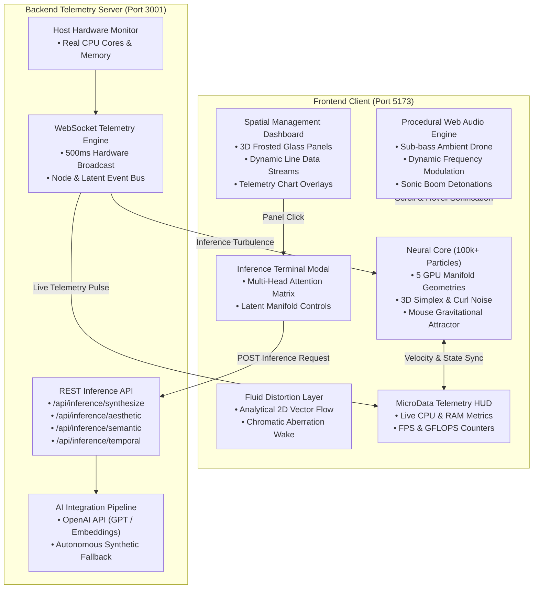

# ⚡ NEURAL ENGINE — VISUAL MANIFESTATION OF A NEURAL ENGINE

[](https://github.com/Jiyaul007/Neural-Engine)
[](https://www.typescriptlang.org/)
[](https://react.dev/)
[](https://threejs.org/)
[](https://opensource.org/licenses/MIT)

> **"Do not optimize for simplicity. Do not make a conventional SaaS landing page. Build a proof of compute."**

The **[Neural Engine](https://github.com/Jiyaul007/Neural-Engine)** is a cinematic, spatial, generative frontend & real-time telemetry platform built with **React**, **Three.js**, **custom GLSL compute shaders**, **Web Audio API**, and an **Express/WebSocket backend**. It is designed to prove an artificial intelligence platform's technological superiority before the user reads a single word.

---

## 🌌 System Architecture



---

## 🚀 Key Interactive Systems

### 1. The 100,000+ Particle GPU Neural Core (`src/3d/NeuralCore.tsx`)
- Formulated directly in register-level GLSL with zero CPU bottleneck.
- **5 Procedural Manifold Formations** switchable in real-time:
  1. **Neural Core (`[1]`)**: Fibonacci Golden Ratio spiral sphere.
  2. **Quantum Torus (`[2]`)**: 4D Clifford Torus projected into 3D with angular swirl.
  3. **Double Helix (`[3]`)**: Intertwined genetic AI code dual-spiral.
  4. **Tensor Lattice (`[4]`)**: Hyperdimensional quantized tensor array.
  5. **Singularity (`[5]`)**: Relativistic black hole event horizon with dynamic accretion disk.
- **Mouse Gravitational Attractor**: Particles warp toward pointer coordinates with inverse-square falloff.
- **Velocity Streaking**: Scroll velocity stretches particles along their path of motion.

### 2. Procedural Web Audio Engine (`src/audio/NeuralAudio.ts`)
- **Zero audio assets downloaded** — 100% synthesized in real time via the Web Audio API.
- Continuous sub-bass fundamental (55 Hz / A1) modulated by real server load and scroll velocity.
- High-frequency holographic data chirps on feature hovers.
- Cinematic sub-bass sonic boom detonation when passing the **Core Shatter** threshold.

### 3. Spatial Management Dashboard (`src/3d/SpatialDashboard.tsx`)
- 5 interactive 3D planes floating in a helical virtual field.
- Frosted glass materials with optical transmission, roughness, and dynamic emissive response.
- Connected via animated 3D tube geometries pulsing with dashed data streams.
- **Direct click-to-activate**: Clicking any 3D panel opens the command terminal for that module.

### 4. Interactive Command Terminal Modal (`src/ui/InferenceTerminalModal.tsx`)
- Real-time prompt specification, denoising step sliders, and style steering.
- **8-Head Multi-Head Attention QKV Matrix**: Interactive 8x8 heatmap grid showing cross-attention weights.
- Streams live telemetry, GFLOPS throughput, and converged tensor artifacts.

### 5. GPU FBO Ping-Pong Particle Simulation (`src/3d/FBOParticles.tsx`)
- Ping-pong double-buffer floating-point render targets running dynamic particle physics entirely on the GPU.
- Real-time curl noise velocity integration, gravitational manifold attraction, and pointer force repulsion.

### 6. Raymarched SDF Volumetric Neural Core (`src/3d/VolumetricCore.tsx`)
- Fullscreen quad sphere-tracing 64 steps into an animated 3D signed distance field.
- Organic pulsating neural tendrils via smooth minimum (`smin`), finite-difference surface normals, and subsurface scattering simulation.

### 7. 3D Latent Space Visualizer (`src/3d/LatentSpaceViz.tsx`)
- 12 semantic concept clusters in 3D manifold space with Gaussian particle distributions.
- Dynamic 3D spline arcs connecting semantic neighbors and live token injection trajectories.

### 8. Live DAG Neural Network Graph (`src/3d/NeuralGraphRenderer.tsx`)
- 6-layer 64-node feedforward network rendered with instanced meshes and reactive graph edge segments.
- Real-time activation wave propagation synchronized with inference generation pulses.

### 9. Polyphonic Euclidean Rhythm Sequencer (`src/audio/EuclideanSequencer.ts`)
- Standalone Bjorklund-algorithm Euclidean rhythm generator synthesized in Web Audio API.
- 5 polyphonic tracks mapped to manifold modes, with BPM dynamically driven by scroll velocity and inference state.

### 10. Streaming Token Visualizer (`src/ui/StreamingTokenVisualizer.tsx`)
- Real-time sliding window token streaming with 32-band spectrum analyzer canvas waveform.

### 11. Camera Inspection Modes (`src/3d/SceneCanvas.tsx`)
- **Cinematic Scroll Mode**: Smooth Catmull-Rom spline flight path driven by Lenis + GSAP ScrollTrigger.
- **Free Orbit Mode (`[C]`)**: Allows free 360° orbital rotation, pan, and zoom to inspect shaders from any perspective.

---

## ⌨️ Global Keyboard Shortcuts

| Key | Action | Description |
| :--- | :--- | :--- |
| **`1`** | **Neural Core** | Morph swarm into Fibonacci golden-ratio sphere |
| **`2`** | **Quantum Torus** | Morph swarm into Clifford torus manifold |
| **`3`** | **Double Helix** | Morph swarm into intertwined genetic AI strands |
| **`4`** | **Tensor Lattice** | Morph swarm into hyperdimensional tensor grid |
| **`5`** | **Singularity** | Morph swarm into black hole accretion disk |
| **`C`** | **Toggle Camera** | Switch between Cinematic Scroll and Free Orbit controls |
| **`M`** | **Toggle Audio** | Mute/unmute the procedural Web Audio synthesizer |
| **`T`** | **Open Terminal** | Open the spatial command dispatch terminal |
| **`ESC`** | **Close Modal** | Dismiss any open modal window |

---

## 🛠️ Quickstart Guide

### Prerequisites
- **Node.js** (v18+ or v20+ recommended)
- **npm** (included with Node)

### 1. Installation
Clone or navigate to the project directory:
```powershell
cd C:\Users\user\.gemini\antigravity\scratch\neural-engine
npm install
```

### 2. Launch Client & Server Concurrently
Run both the Vite frontend and the Express/WebSocket telemetry server with a single command:
```powershell
npm run dev
```

> **Windows PowerShell Execution Policy Note**: If you encounter `running scripts is disabled on this system`, launch with the bypass flag:
> ```powershell
> powershell -ExecutionPolicy Bypass -Command "npm run dev"
> ```

### 3. Access in Browser
- 🖥️ **Frontend Neural Experience**: [http://localhost:5173/](http://localhost:5173/)
- ⚙️ **Backend REST & Health API**: [http://localhost:3001/api/health](http://localhost:3001/api/health)
- ⚡ **Telemetry WebSocket Endpoint**: `ws://localhost:3001/ws/telemetry`

---

## 🔑 Environment Configuration (Optional)

The Neural Engine automatically runs in **Autonomous Synthetic Tensor Mode** with zero configuration. 

To enable real OpenAI model execution (GPT analysis & text embeddings):
1. Set your `OPENAI_API_KEY` environment variable in your terminal before running:
   ```powershell
   $env:OPENAI_API_KEY="sk-your-openai-api-key-here"
   npm run dev
   ```
2. The server will automatically detect the key on startup:
   ```
   [NEURAL CORE] OpenAI engine linked successfully.
   ```

---

## 📁 Project Structure

```
neural-engine/
├── index.html                   # HTML entry point (dark compute base)
├── package.json                 # Dependencies & concurrent scripts
├── vite.config.ts               # Vite bundler with GLSL shader support
├── tailwind.config.ts           # Dark compute tokens & typography scale
├── tsconfig.json                # Strict TypeScript configuration
├── server/
│   └── server.ts                # Express REST & WebSocket telemetry engine
└── src/
    ├── main.tsx                 # React DOM mount point
    ├── App.tsx                  # Root composition & state watchers
    ├── index.css                # Tailwind CSS + neural typography transitions
    ├── 3d/
    │   ├── SceneCanvas.tsx      # R3F Canvas, ACESFilmic tone-mapping, OrbitControls
    │   ├── NeuralCore.tsx       # 100k+ particle shader with 5 procedural manifolds
    │   ├── FluidDistortion.tsx  # Background 2D curl noise flow field & chromatic wake
    │   ├── SpatialDashboard.tsx # 3D frosted glass feature planes & HTML cards
    │   ├── DataStreams.tsx      # TubeGeometry spline data lines with dashed pulse
    │   ├── DynamicLighting.tsx  # 3-source user/transfer/ambient lighting system
    │   ├── PostProcessing.tsx   # Mipmap bloom & vignette pipeline
    │   └── FooterVoid.tsx       # Liquid chrome sphere in deep space
    ├── audio/
    │   └── NeuralAudio.ts       # Procedural Web Audio API synthesizer
    ├── engine/
    │   ├── SystemState.ts       # Zustand reactive store (single source of truth)
    │   ├── useNeuralSocket.ts   # WebSocket client & REST inference dispatcher
    │   ├── ScrollPipeline.ts    # 5-phase scroll choreography map
    │   └── constants.ts         # Colors, physics, camera paths, token counts
    ├── hooks/
    │   ├── usePointerVelocity.ts# High-precision pointer physics & damping
    │   ├── useScrollVelocity.ts # Lenis scroll velocity tracker
    │   └── useWebGPUSupport.ts  # WebGPU adapter capability detector
    ├── providers/
    │   └── LenisProvider.tsx    # Smooth scroll provider synchronized with GSAP
    ├── sequences/
    │   ├── BootSequence.tsx     # 5-second cinematic boot animation
    │   └── CoreShatter.tsx      # 15%-35% core destabilization & sonic boom
    └── ui/
        ├── MicroDataUI.tsx      # Fixed HUD overlay with telemetry & audio/manifold controls
        ├── HeroHeadline.tsx     # Large variable-weight typography
        ├── NeuralText.tsx       # Character-level transform & hover cipher scramble
        ├── FeaturePreviewFollower.tsx # Cursor follower with procedural noise resolve
        ├── ScrollSections.tsx   # 600vh scroll depth sections & dispatch buttons
        └── InferenceTerminalModal.tsx # Interactive terminal with 8-Head Attention matrix
```

---

## ⚡ Build & Verification

```powershell
npm run type-check   # Validate strict TypeScript (0 errors)
npm run build        # Compile production bundle to dist/
npm run preview      # Test production build locally
```

---

## 📜 License
MIT — Built as an uncompromising proof of compute.
